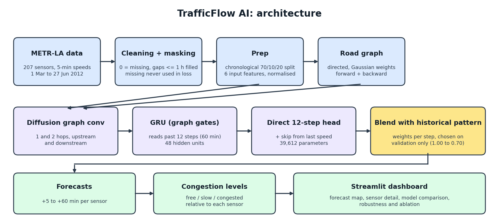
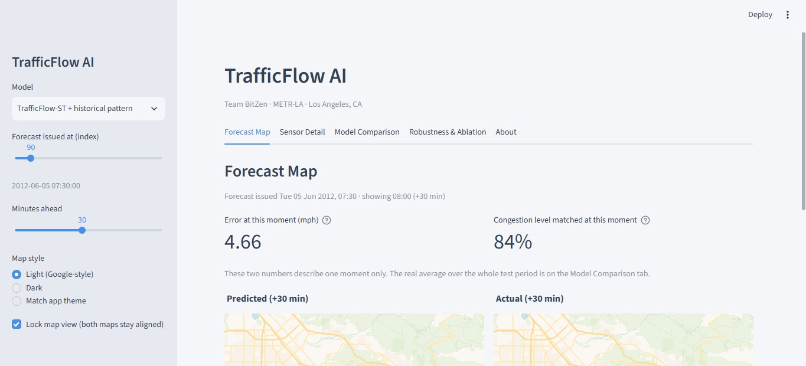
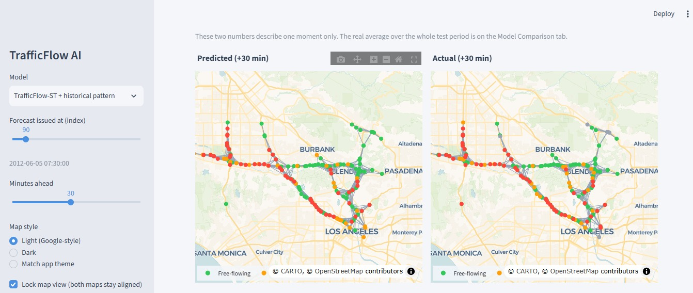
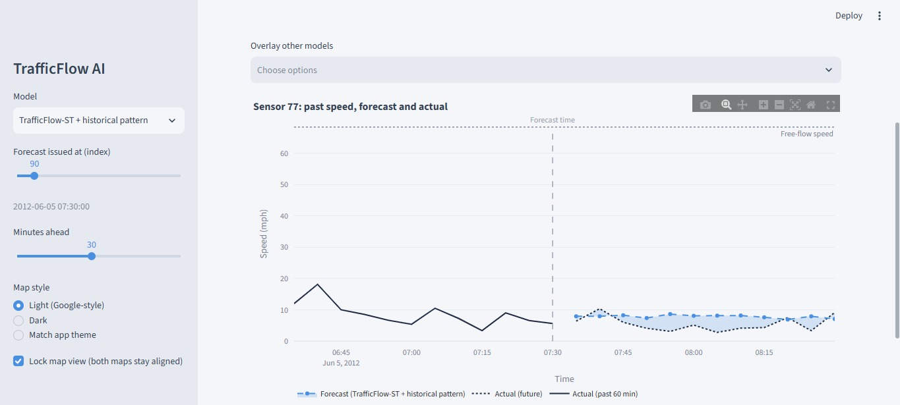
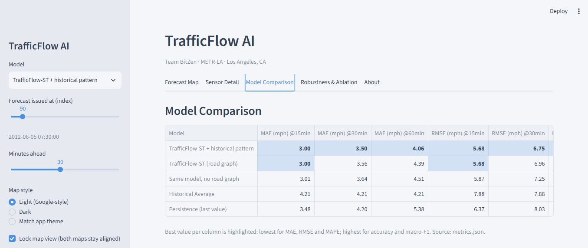
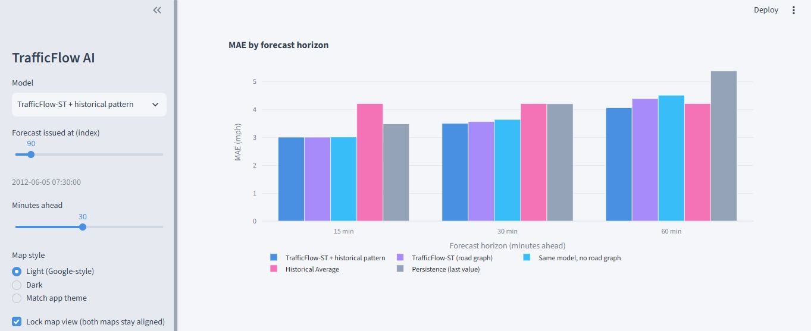
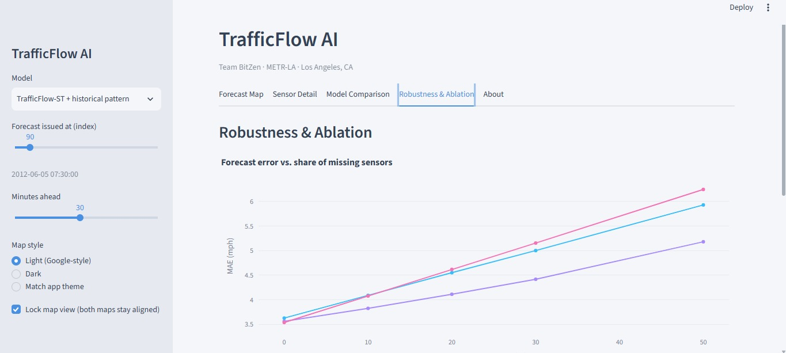
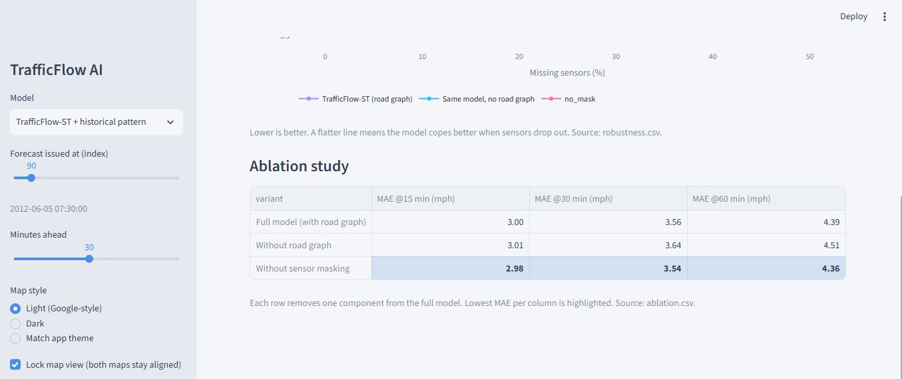

# TrafficFlow AI

**Forecasting traffic speed and congestion up to 60 minutes ahead, using the road network itself.**
Team BitZen | AI Innovation Hackathon 2026, Challenge 06

- Live dashboard: https://trafficflow-ai-tzddyehsg9owsfg2rkq7am.streamlit.app/

- Demo video: https://drive.google.com/file/d/1y1X4hNkZ0tKEzdR3wsgGg_r6FcueRWJK/view?usp=sharing

## Problem
Congestion forms and spreads across connected roads within minutes, but most tools only show current conditions. Drivers and traffic operators need to know what is coming, and sensors break, so a forecast must still work when data is missing.

## Solution
TrafficFlow AI forecasts the speed at every sensor for the next 60 minutes (in 5-minute steps) with a compact graph-based spatiotemporal model, and turns the forecasts into congestion levels on an interactive map. The final model is a **blend** of the neural network and the historical daily pattern, with the mix chosen on validation data only.



**TrafficFlow-ST** (39,612 parameters): diffusion graph convolution (1 and 2 hops, upstream and downstream) inside a GRU, a direct 12-step output head, and a skip connection from the last observed speed. It reads the past 60 minutes and predicts the next 60. Training uses a masked MAE loss and random sensor masking (0 to 20% of sensors hidden per batch) for robustness.

**Final model (`trafficflow_blend`)**: a weighted mix of TrafficFlow-ST and the Historical Average, one weight per forecast step, chosen on the validation set. The weight on the neural model falls from 1.00 (first 15 minutes) to 0.70 (at 60 minutes), because long-range traffic is dominated by the daily cycle. This is a standard ensemble technique and we describe it as a blend, not a pure neural network.

**Congestion levels** are relative to each sensor's free-flow speed (95th percentile of its training speeds): free-flowing at ratio 0.80 or more, slow from 0.50 to 0.80, congested below 0.50, grey for no data.

## Dataset and credits
METR-LA: speeds from 207 loop detectors on Los Angeles highways, one reading every 5 minutes, 1 March to 27 June 2012 (34,272 time steps). Public, aggregated data. No vehicle IDs, no location traces, no personal data. Dataset credit: METR-LA via the DCRNN project (Li, Yu, Shahabi, Liu, ICLR 2018).

Cleaning: a speed of 0 means the sensor sent nothing, so zeros become missing values (8.11% of readings). Gaps up to 1 hour are linearly interpolated; longer gaps stay missing (7.23%). Missing values are excluded from the loss and from every metric.

Split: chronological, never shuffled. 70% train, 10% validation, 20% test (23,967 / 3,404 / 6,832 windows). Normalisation uses training data only.

## Results
Test set, 6,832 forecasts. Mean absolute error in mph (lower is better).

| Model | MAE 15 min | MAE 30 min | MAE 60 min | RMSE 60 min | Congestion accuracy (30 min) | Macro-F1 (30 min) |
|---|---|---|---|---|---|---|
| Historical Average | 4.21 | 4.21 | 4.21 | 7.88 | 0.863 | 0.663 |
| Persistence | 3.48 | 4.20 | 5.38 | 10.34 | 0.877 | 0.699 |
| TrafficFlow-ST (road graph) | 3.00 | 3.56 | 4.39 | 8.59 | 0.891 | 0.715 |
| Same model, no road graph | 3.01 | 3.64 | 4.51 | 8.97 | 0.889 | 0.709 |
| **TrafficFlow-ST + historical pattern (final)** | **3.00** | **3.50** | **4.06** | **7.70** | **0.892** | **0.718** |

The final model has the lowest error at 15, 30 and 60 minutes. The neural network alone does not beat the Historical Average at 60 minutes (4.39 against 4.21); the blend does (4.06).

### Robustness
At test time a random share of sensors is hidden (speed and observed flag zeroed). MAE averaged over all 12 forecast steps, on every 4th test window.

| Missing sensors | 0% | 10% | 20% | 30% | 50% |
|---|---|---|---|---|---|
| TrafficFlow-ST (road graph, with masking) | 3.56 | 3.82 | 4.11 | 4.42 | 5.18 |
| Without road graph | 3.63 | 4.09 | 4.55 | 5.00 | 5.93 |
| Without sensor masking in training | 3.54 | 4.08 | 4.62 | 5.15 | 6.24 |

With half the sensors missing, error grows by 45% for the full model, 63% without the road graph and 76% without sensor masking. Neighbouring sensors fill in for missing ones, and training with masked sensors teaches the model to rely on them.

### Ablation
| Variant | MAE 15 min | MAE 30 min | MAE 60 min |
|---|---|---|---|
| Full model (road graph + sensor masking) | 3.01 | 3.57 | 4.39 |
| Without road graph | 3.01 | 3.64 | 4.51 |
| Without sensor masking | 2.98 | 3.54 | 4.36 |

The road graph helps at 30 and 60 minutes and clearly helps when sensors are missing. Sensor masking costs almost nothing on complete data (the no-masking variant is slightly better there, by about 0.03 mph) and gives a large gain when sensors fail: 5.18 against 6.24 mph at 50% missing.

## How to reproduce
```bash
pip install -r requirements-train.txt
python data/download_data.py
python src/data.py
python src/prep.py
python src/baselines.py
python src/train.py --name trafficflow_st --minutes 25
python src/train.py --name no_mask --no_mask --minutes 25   # ablation (variant flags: see src/train.py)
python src/finalize.py   # robustness, ablation, export to app_data/
python src/blend.py      # final blend (run after finalize.py)
```
Training budget: 25 minutes on a laptop CPU per model, seed 42.

## Run the dashboard
```bash
pip install -r requirements.txt
python -m streamlit run app/streamlit_app.py
```
Tabs: Forecast Map (predicted against actual), Sensor Detail, Model Comparison, Robustness and Ablation, About.

## Screenshots
Real dashboard running on the final `app_data/` (forecast issued Tue 5 June 2012, 07:30, rush hour).

### Forecast Map: predicted against actual, 30 minutes ahead



### Sensor Detail: past speed, forecast and what really happened


### Model Comparison



### Robustness and Ablation



## Limitations and ethics
- **Geography and age:** Los Angeles highways, data from 2012. Patterns have changed since (remote work, new roads). Another city needs its own road graph and sensor history, and retraining.
- **Coverage:** sensors sit on major highways, not neighbourhood streets.
- **Uncertainty:** error grows with the forecast horizon; 60-minute forecasts are the least reliable.
- **Model size:** a compact model trained for 25 minutes on a CPU. Validation error was still falling, so longer training would improve it. Published models on METR-LA reach lower error (for example DCRNN at 2.67, 3.08 and 3.56 mph MAE at 15, 30 and 60 minutes) with hours of GPU training and possibly a slightly different protocol. We do not claim state-of-the-art results.
- **Final model is a blend** of a neural network and the historical pattern.
- **Decision support only:** not a replacement for human traffic control, and not for sole use in emergency routing.
- **Privacy:** public aggregated sensor speeds only.

## Future work
Longer training on a GPU, learned (adaptive) graph edges, uncertainty intervals on forecasts, more cities and recent data, live sensor feeds.

## Team
Team BitZen: Ishrattaj Dharwad (backend, model, evaluation) and Farhan Dharwad (frontend dashboard). Thanks to the DCRNN authors for METR-LA and the road-graph recipe.